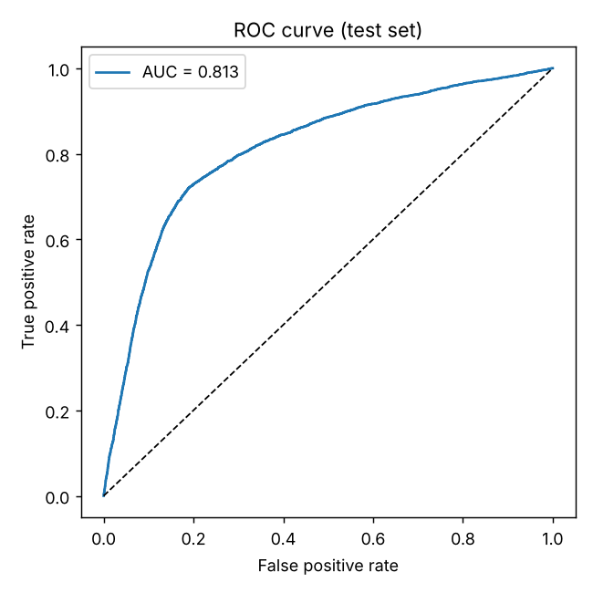
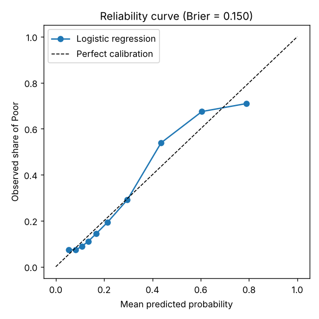
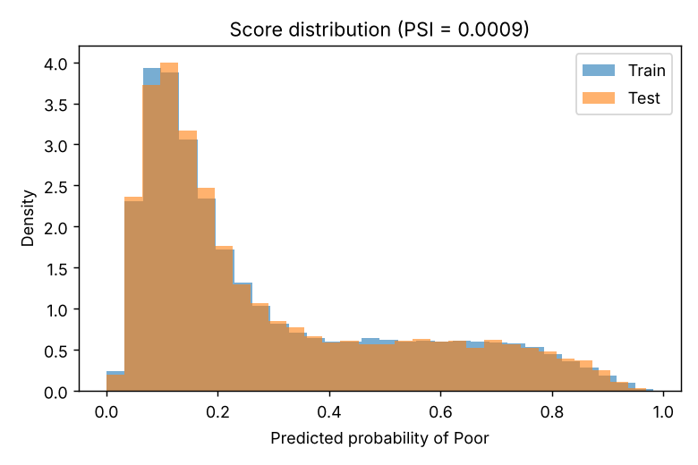
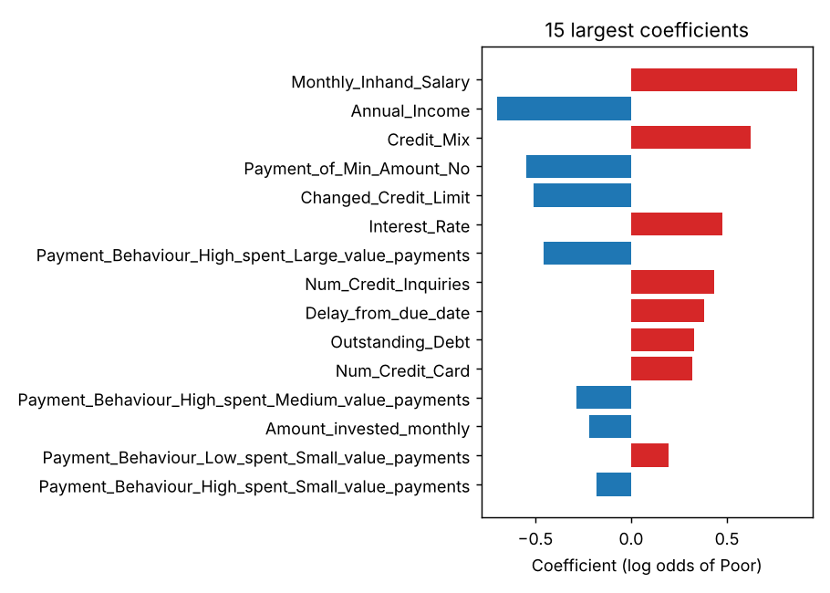

# Credit risk: Credit Score classification

**Status: Work in progress.** This is a first baseline, not a finished model.

## Objective

I want to build a clean and reproducible credit risk project, from raw data to an evaluated model. The idea is to start with a simple logistic regression, measure it properly (discrimination, calibration, stability), and then see what a more flexible model brings on top of it.

## Dataset

- Name: Credit score classification
- Source: Kaggle, user `parisrohan` ([link](https://www.kaggle.com/datasets/parisrohan/credit-score-classification))
- Content: 100,000 rows in `train.csv`, which is 12,500 customers observed over 8 months (January to August). 28 columns: income, debts, credit cards, payment delays, type of loans, etc.
- Target: `Credit_Score`, with three classes (Poor, Standard, Good). About 29% Poor, 53% Standard, 18% Good.
- `test.csv` from Kaggle has no target column, so I do not use it. I make my own test set from `train.csv`.
- Licence: **I could not check it** (the Kaggle page was not reachable when I prepared the repo). Please read it on the Kaggle page before reusing the data. This repo does not contain any data, you download it yourself.

How to download: create a Kaggle account, generate an API token in your account settings, then either put it in the environment (`KAGGLE_API_TOKEN`, or `KAGGLE_USERNAME` and `KAGGLE_KEY`) or in `~/.kaggle`. `python run_all.py` then downloads the files into `data/raw/`. No credential is stored in the repo.

## Repo structure

```
run_all.py               runs everything
requirements.txt         pinned versions
scripts/
  download_data.py       downloads the dataset with the Kaggle API
  clean_data.py          cleaning
  train_baseline.py      split, logistic regression, metrics, figures
data/                    ignored by git (raw files go in data/raw/)
reports/
  metrics.json           all the metrics below
  coefficients.csv       coefficients and odds ratios
  figures/               ROC, calibration, score distribution, coefficients
```

## How to run

```
pip install -r requirements.txt
python run_all.py
```

It takes about one minute. The versions in `requirements.txt` are the ones I ran with (Python 3.13). The seed is fixed (42).

One limit: I tested the whole pipeline with `train.csv` already in `data/raw/`. The Kaggle download itself was not tested with real credentials. I only checked that the script stops with a clear message when no credential is found.

## Methodology

**Target.** The original target has three classes. For a first credit risk baseline I made it binary: `Poor` = 1 ("bad" customer), `Standard` or `Good` = 0. This is my choice, and it lets me use the usual risk metrics (AUC, Gini, KS). The score of the model is the predicted probability of being Poor.

**Cleaning** (`scripts/clean_data.py`). The data is dirty: numbers stored as text, placeholder values such as `_______` or `!@9#%8`, impossible values (ages below 18 or far above 100, hundreds of bank accounts).
- Numeric columns are converted with `pd.to_numeric(errors='coerce')`, so what cannot be read becomes missing.
- Impossible values are set to missing, with one threshold per column (for example age outside 18 to 110, more than 15 credit cards, income above 500,000). I looked at `describe()` and quantiles to choose them. I did it on the whole `train.csv` before the split, so these thresholds were not chosen on the training set only. They are simple rules and I do not expect a big effect, but it is a small leak of my own choices.
- Missing values are filled with the customer's own other months: the median for continuous variables, the most frequent value for counts and categories. A customer keeps roughly the same profile from one month to the next, so this seemed more faithful than a global median. It only uses rows of the same customer, so nothing moves from one customer to another.
- `Type_of_Loan` is a list written as text, so I turned it into one 0/1 column per type of loan.
- `Credit_History_Age` ("22 Years and 1 Months") is converted to months.
- Dropped: name, SSN, ID (identifiers). `Customer_ID` is only used to group rows. `Month` is not used as a feature.

**Missing values that remain.** Some customers have no valid value at all over their 8 months (for example `Age` for 5,512 rows, `Interest_Rate` for 1,528, `Total_EMI_per_month` for 288). They are filled in the sklearn pipeline with the median (or most frequent value), computed on the training set only.

**Split.** There is no year in the data, only month names from January to August. A split in time would put the same customers in train and test, so I did not do it. Instead, I do a stratified split grouped by `Customer_ID`: 80% of the customers in train, 20% in test, and no customer in both (checked in the code). Stratified means the share of Poor is the same in both sets.

**Model.** Logistic regression (scikit-learn defaults, L2 penalty, no class weights, so that the probabilities stay usable). Numeric variables are standardised, `Credit_Mix` is encoded as an ordered variable (Bad < Standard < Good), the other categories are one-hot encoded. Everything is fitted on the training set only.

## First results

Test set: 20,008 rows, 2,501 customers, 29.0% Poor.

Definitions:
- **AUC**: probability that a random Poor customer gets a higher score than a random non-Poor customer. 0.5 is random, 1 is perfect.
- **Gini** = 2 x AUC - 1. Same information as the AUC, on a scale from 0 to 1.
- **KS** (Kolmogorov-Smirnov): the biggest gap between the share of Poor and the share of non-Poor customers captured when we go through the scores. Higher means a better separation.
- **Brier score**: mean squared gap between the predicted probability and the real outcome (0 or 1). Lower is better. As a reference, always predicting the share of Poor of the training set gives 0.206.
- **PSI** (Population Stability Index): compares the distribution of a variable (or of the score) between two samples. A common rule of thumb says below 0.1 is stable, above 0.25 is a big shift.

| Metric | Train | Test |
|---|---|---|
| AUC | 0.814 | 0.813 |
| Gini | | 0.626 |
| KS | | 0.531 |
| Brier score | | 0.150 |
| Precision at threshold 0.5 | | 0.687 |
| Recall at threshold 0.5 | | 0.504 |

Accuracy is not very informative with 29% of Poor, so I give precision and recall for the Poor class instead, at the default threshold of 0.5. The threshold was not tuned.

PSI between train and test:

| Variable | PSI |
|---|---|
| Score | 0.0009 |
| Monthly_Inhand_Salary | 0.0031 |
| Annual_Income | 0.0047 |
| Credit_Mix | 0.0005 |
| Payment_of_Min_Amount | 0.0005 |
| Changed_Credit_Limit | 0.0022 |

The 5 variables are the ones with the largest coefficient in absolute value. These PSI values are very small, but this is expected: train and test are a random split by customer of the same 8 months. It says the split is balanced, not that the model would be stable over time. I have no later data to check that.

Figures:






**Calibration.** The reliability curve groups customers by predicted probability and compares it to the observed share of Poor. It follows the diagonal fairly well, but not perfectly: in the middle (predicted around 0.4 to 0.6) the observed share of Poor is higher than predicted, and at the top (predicted around 0.8) it is lower.

**Coefficients.** Numeric variables are standardised, so an odds ratio is the change in the odds of being Poor for +1 standard deviation of the variable. Above 1 means more risk. The full list is in `reports/coefficients.csv`.

| Variable | Odds ratio |
|---|---|
| Monthly_Inhand_Salary | 2.38 |
| Annual_Income | 0.50 |
| Credit_Mix (ordered Bad < Standard < Good) | 1.86 |
| Payment_of_Min_Amount = No | 0.58 |
| Changed_Credit_Limit | 0.60 |
| Interest_Rate | 1.61 |
| Num_Credit_Inquiries | 1.54 |
| Delay_from_due_date | 1.47 |
| Outstanding_Debt | 1.39 |

Plain reading: more interest rate, more credit inquiries, more payment delay and more outstanding debt go with a higher risk of Poor, which is what I expected. Two coefficients should not be read one by one:
- `Monthly_Inhand_Salary` and `Annual_Income` are almost the same variable (correlation 0.99). The model gives them opposite signs, which cancel each other. Only the pair means something.
- `Credit_Mix` has a positive coefficient, meaning a better mix goes with more risk. This is surprising, since 60% of the customers with a "Bad" mix are Poor against 16% for "Good". When I fit the model with `Credit_Mix` alone, the coefficient is negative (-0.82). It becomes positive once variables like the interest rate and the outstanding debt are added, because they are strongly linked to `Credit_Mix`. I think it is a collinearity effect and not an error in the encoding (I checked that Bad, Standard, Good are coded 0, 1, 2), but I have not gone further than that.

## Limits and next steps

- The target is binary by my choice. A three-class version would use the full information.
- Rows of the same customer are not independent (8 months each), so the metrics are computed on correlated rows. A single split on 2,501 test customers also gives no idea of the uncertainty. A grouped cross-validation would help.
- No time dimension, so no real out-of-time test and no real stability check.
- The scores are only reliable as far as this dataset is: the link between the variables and `Credit_Score` is strong here, and I do not know how the score was built.
- Correlated variables (salary and income, `Credit_Mix` and the rate) make the coefficients hard to read. Removing one of each pair, or using a penalty such as L1, is a next step.
- Next steps: gradient boosting (random forest and boosted trees, compared with the same grouped split), better calibration (for example isotonic or Platt calibration), a scorecard (binning of the variables and points per class), and a threshold chosen from a cost argument instead of 0.5.

**Work in progress.**
